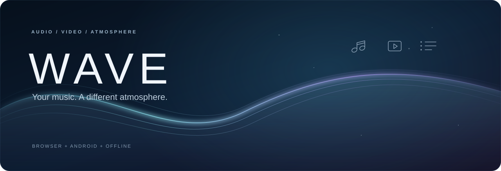
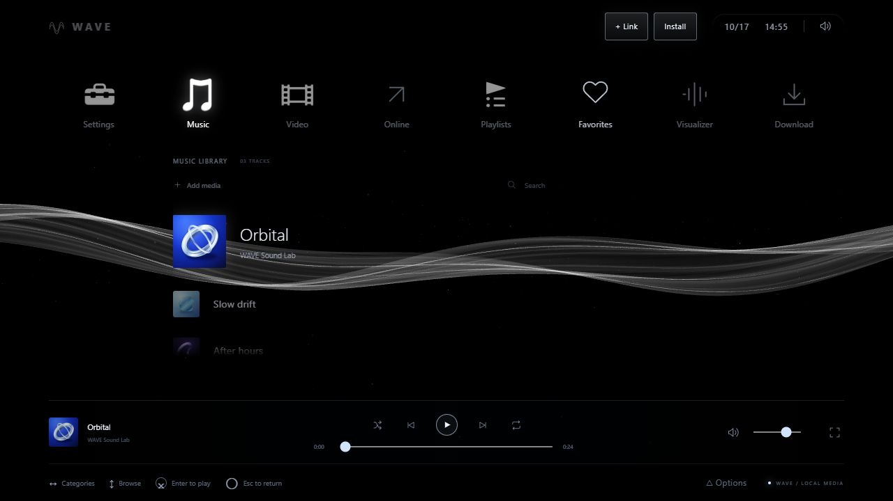
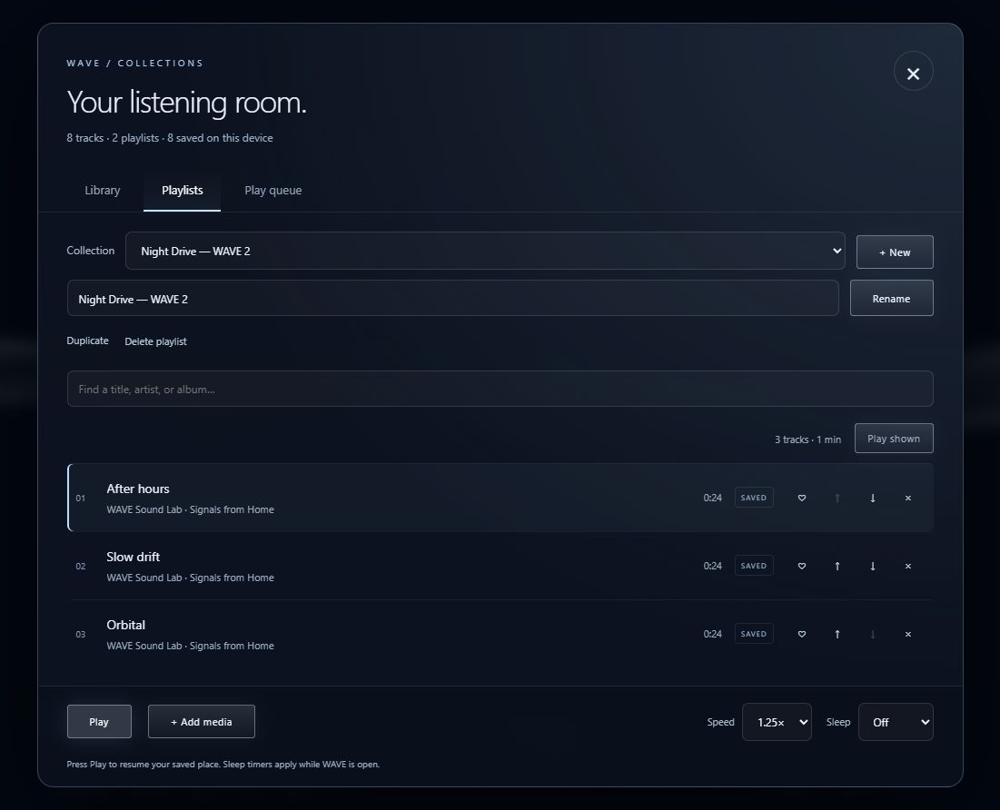

<div align="center">



### Your library. Your device. Your atmosphere.

A console-inspired audio & video player with flowing light, an XMB-style menu,<br>
an editable play queue, and a place for the files you already love.

[](https://daronthedragon.github.io/wave-player/)
[](https://github.com/daronthedragon/wave-player/releases/latest/download/WAVE-Player.apk)
[](https://github.com/daronthedragon/wave-player/releases/latest/download/WAVE-Player.html)

**No WAVE account · Local media stays local · No Electron**

[New in 2.0](#your-collection-in-focus) · [Features](#made-for-listening) · [Install](#pick-your-player) · [Online links](#youtube--soundcloud) · [Complete guide](docs/GUIDE.md) · [Releases](https://github.com/daronthedragon/wave-player/releases)

</div>

---

<a href="https://daronthedragon.github.io/wave-player/">
  
</a>

## Pocket player, real MP3 files

**WAVE 2.1 adds an MP3 saver and an iPhone/iPad app target.** Choose the down-arrow beside a track in Library, or **Track options → Save as MP3**. WAVE encodes a real 192 kbps MP3 on your device. Keep the copy in WAVE for offline replay and playlists, download it, or use the file-sharing sheet where supported. The original stays unchanged.

The browser’s initial offline shell is about **415 KB** of source assets. The **32.3 MB** converter is fetched only when you first request MP3 export or format conversion, then cached for reuse. The portable HTML and native app bundle the converter so they can convert offline from first launch.

**iOS application:** a dedicated Capacitor/WKWebView project and macOS build workflow are in [ios/](ios/README.md). The iPhone build is unsigned and **must be signed before installation**; there is no public TestFlight or App Store release yet. Safari’s **Add to Home Screen** remains available immediately. The new app target does not add direct YouTube/SoundCloud extraction.

MP3 export works on audio already imported or retrieved into WAVE. It does not make an unplayable YouTube/SoundCloud bookmark downloadable. See the [provider limitations](#youtube--soundcloud) before choosing a platform.

## Your collection, in focus

**WAVE 2.0 brings a new library workspace to the familiar XMB.** Open **Library** to find a track, build a collection, or line up the rest of your evening.

<a href="https://daronthedragon.github.io/wave-player/">
  
</a>

| Find your next track | Shape your session |
| :--- | :--- |
| **Search & sort** — title, artist, album, recently added, or duration. | **Editable queue** — play next, add selected tracks, reorder upcoming tracks, and remove queue entries. |
| **Quick filters** — audio, video, favorites, and files saved offline. | **Remember your place** — reopen at your saved track and position, ready for you to press Play. |
| **Playlist tools** — select several tracks, rename, duplicate, reorder, or delete collections. | **Speed & sleep** — choose 0.5–2× playback and a 15, 30, 60, or 90 minute pause timer. |

Your existing saved media and playlists stay in place when updating. Queue and playback preferences are remembered on this device when storage is available. The sleep timer lasts for the current session; browser or OS suspension can delay it. [Explore the new controls →](docs/GUIDE.md#library-and-playlists)

## Made for listening

**An interface with a little atmosphere.** Move across categories, browse a vertical library, and let luminous waves follow your music. WAVE takes inspiration from the PS3 home screen while keeping your own media at the center.

| Listen & watch | Make it yours |
| :--- | :--- |
| **Audio + video** — import files or drop them into the player. | **Three visualizers** — Flow, Spectrum, and Orbit respond to your music. |
| **A library that stays** — save media and playlists on your device. | **XMB-style navigation** — keyboard, mouse, and touch controls. |
| **Local conversion** — bundled FFmpeg handles many formats your browser cannot decode. | **Color atmospheres** — change the mood or enable reduced motion. |
| **Offline playback** — listen to saved files without a connection. | **Choose your home** — browser, Home Screen web app, Android APK, or offline HTML. |

## Pick your player

| | Get started | What to expect |
| :--- | :--- | :--- |
| **Web** | [Open WAVE](https://daronthedragon.github.io/wave-player/) | Import audio/video and save playlists in this browser. |
| **iPhone / iPad** | Open the website in Safari → **Share → Add to Home Screen** | An installable web app. Open online once to cache the player. |
| **Android APK** | [Download the APK](https://github.com/daronthedragon/wave-player/releases/latest/download/WAVE-Player.apk) | Bundled offline player, native file picker, and on-device provider audio importer. |
| **Android web app** | Open the website in Chrome → **Install / Add to Home screen** | The web version in its own launcher; capabilities differ from the APK. |
| **Desktop / portable** | [Download the HTML](https://github.com/daronthedragon/wave-player/releases/latest/download/WAVE-Player.html) | One approximately 43 MB file. Double-click to open in your browser. |

**Updating Android? Install the new APK over the existing app to retain your library.** Clearing site/app data or uninstalling can delete saved media. Keep your original files; libraries are local and do not sync between devices or installations. [Installation & storage details →](docs/GUIDE.md#iphone-and-android)

## YouTube & SoundCloud

Paste a source URL with **+ Link**. What happens next depends on where WAVE runs:

| Capability | GitHub website / Home Screen app | Android APK |
| :--- | :--- | :--- |
| Save source links | Yes | Yes |
| Play imported files & keep playlists | Yes | Yes |
| Retrieve provider audio without a WAVE server | **Unavailable** | On-device importer for supported public tracks |
| SoundCloud verification | Link bookmarks; import an audio file to play in WAVE | Real audio import and decoding passed emulator checks |
| YouTube verification | Link bookmarks; import an audio file to play in WAVE | Implemented, but the live emulator check hit YouTube verification; physical-phone playback remains unverified |

> **The website and iPhone Home Screen app cannot extract YouTube or SoundCloud audio directly without a server or provider embeds.** WAVE currently uses neither a shared audio backend nor provider embeds. Saving a link on these versions creates a bookmark, not a playable audio download.

The Android APK uses a bundled **yt-dlp** runtime on your device. Supported downloads become local Music files and can be added to playlists. YouTube can return **“Sign in to confirm you’re not a bot”**, which prevents import; WAVE does not bypass that verification. Provider changes can also require an APK update. A separate local desktop YouTube download/playback check passed, but does not establish phone or static-website support.

Downloads support individual public tracks, with a **64 MiB** limit and **three-minute** processing timeout. They must finish before playback. No private/login-required media, live streams, provider-blocked content, or whole provider playlists. Use media you have permission to access and retain.

[Full link support & known limitations →](docs/GUIDE.md#youtube-and-soundcloud-links) · [Optional local desktop companion →](server/README.md)

## Settle in

1. **Add your media** with the file picker or drag and drop.
2. **Open Library**, select tracks, and add them to an existing or new playlist.
3. **Shape the queue**, choose your playback speed, and set a sleep timer if you want.
4. **Open a visualizer** and choose Flow, Spectrum, or Orbit.

| Control | Action |
| :--- | :--- |
| **← / →** · **↑ / ↓** | Change category · Select an item |
| **Enter** · **Space** | Open or play · Play / pause |
| **Shift + ← / →** | Seek five seconds |
| **/** · **Escape** | Search music · Return to the menu |

Common formats include MP3, WAV, FLAC, Ogg, Opus, AAC/M4A, MP4, WebM, and MOV. Actual playback depends on the file’s codecs and your browser. The local converter supports many additional formats, with a **256 MB input limit**; universal format support is not guaranteed. [Formats & conversion →](docs/GUIDE.md#audio-video-and-local-conversion)

## Build your own

Plain HTML, CSS, and JavaScript. **Node.js 22.12+**, no dependency installation required.

```sh
git clone https://github.com/daronthedragon/wave-player.git
cd wave-player
npm run build
npm run dev
```

Open **http://127.0.0.1:4173**. Run `npm test` for functional tests; `npm run build` produces the website and standalone HTML in `dist/`.

[Complete guide](docs/GUIDE.md) · [Android build & signing](android/README.md) · [Release & deployment notes](docs/GUIDE.md#releases-and-deployment)

## Credits & licenses

WAVE is an independent project, unaffiliated with Sony or PlayStation. Its wave renderer adapts [linkev’s PlayStation-3-XMB recreation](https://github.com/linkev/PlayStation-3-XMB). Original WAVE source is **MIT**; combined downloadable HTML program code is **GPL-2.0-or-later**, and the combined Android program is **GPL-3.0**. Separately copyrighted PS3 image assets are excluded from those code licenses.

[WAVE license](LICENSE) · [Renderer notice](vendor/ps3-xmb/NOTICE.md) · [PS3 artwork notice](assets/ps3/NOTICE.md) · [FFmpeg notice](vendor/ffmpeg/NOTICE.md) · [Android notices](android/THIRD_PARTY_NOTICES.md) · [Full attribution](docs/GUIDE.md#artwork-and-attribution)

---

<div align="center">

**WAVE** · Built for your own collection.<br>
[daronthedragon / wave-player](https://github.com/daronthedragon/wave-player)

</div>
